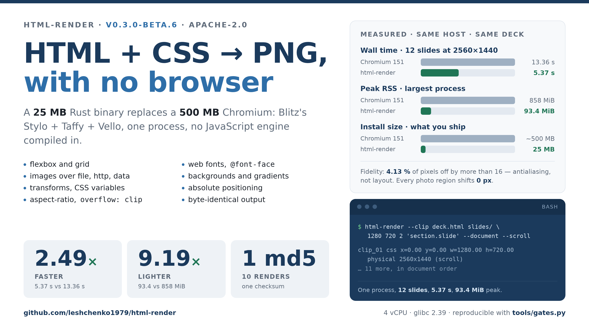

# html-render



**HTML + CSS → PNG, with no browser.**

**Linux x86_64, glibc ≥ 2.35.** No macOS, no Windows, no Docker image.

```bash
# the image above is this command's output, byte for byte
html-render assets/hero.html hero.png 1600 900 2 --document
```

A small Rust CLI that renders real documents — stylesheets, flexbox, grid, images,
web fonts — using [Blitz](https://github.com/DioxusLabs/blitz)'s Stylo + Taffy +
Vello pipeline. No Chromium, no JavaScript engine, one process.

## Status

`0.3.0-beta`, ten days old, one maintainer. No API promise: flags and output
names may change between minor versions. Linux only. One known layout defect —
four corpus boxes, consecutive `<br>` runs in a `font-size:0` inline-block
context (see [Corpus](#corpus)).

It exists to answer a concrete question: can a 25 MB binary replace a 500 MB
browser for server-side rendering? On a real 12-slide, 4 MB deck, yes:

| 12-slide deck, 2560×1440 | wall | peak RSS |
|---|---|---|
| headless Chromium (Playwright) | 13.36 s | 858 MiB |
| **html-render** | **5.37 s** | **93.4 MiB** |

**2.49× faster, 9.19× lighter** — and byte-for-byte deterministic, which a browser
is not: ten renders of the same input produce one checksum, so output can be
diffed in CI. That holds for a document whose resources are local or `data:`
URIs. A remote image is fetched at render time and painted as **absent** if it
misses `BLITZ_DEADLINE_SECS` (default 120 s), so a slow origin changes the
picture without changing the input.

The deck is not part of this repo (4.16 MB, embedded JPEGs, four `@font-face`
faces). Every figure here and in [GATES.md](GATES.md) is reproduced from your own
document with `python3 tools/gates.py --deck <path>` — a different deck gives
different numbers by construction.

[`assets/demo-deck.html`](assets/demo-deck.html) is a four-slide, 4 KB layout
fixture in the repo, so the two recipes are runnable from a fresh clone without
that deck:

```bash
# four slides out, one PNG per section.slide
html-render --clip assets/demo-deck.html slides/ 1280 720 2 'section.slide' --document

# determinism: ten renders, one checksum
for i in $(seq 10); do html-render assets/demo-deck.html /tmp/r$i.png 1280 720 1 --document; done
sha256sum /tmp/r*.png | awk '{print $1}' | sort -u | wc -l   # → 1
```

## Use cases

Four things this is used for, each one a file you can name:

- **Slide images from HTML/CSS.** A deck authored as `<section class="slide">`
  becomes one PNG per slide at any scale, with no browser in the loop —
  `--clip` writes `clip_01.png`, `clip_02.png`, … in document order.
- **Open Graph and social cards.** [`assets/og.png`](assets/og.png) is 1280×640,
  rendered from [`assets/og.html`](assets/og.html) by the command in
  [Usage](#usage).
- **CI visual diffs.** Deterministic output makes a changed pixel a changed
  document: commit the PNG, diff the PNG, fail the build.
- **Report and chart images.** One-pagers and dashboards where the layout is CSS
  and the alternative is a screenshot service you have to keep warm.

## Install

No package manager, no toolchain — a static-ish binary plus glibc. From a
[release](https://github.com/leshchenko1979/html-render/releases):

```bash
V=v0.3.0-beta.4-r2
N=html-render_0.3.0-beta.4-r2_linux_amd64
BASE="https://github.com/leshchenko1979/html-render/releases/download/$V"

curl -fsSL -O "$BASE/$N.tar.gz"
curl -fsSL -O "$BASE/checksums.txt"
sha256sum -c checksums.txt
tar xzf "$N.tar.gz"
install -m755 html-render /usr/local/bin/html-render
```

Every release verifies its own asset: the workflow downloads the published
tarball back over HTTPS, checks `checksums.txt`, byte-compares it with the build,
renders a PNG and asserts its dimensions. A release serving the wrong file fails
its own run.

## Usage

Two modes. Both take the **viewport in CSS pixels**; `scale` multiplies the
output resolution (scale 2 → a 1280×720 viewport produces 2560×1440).

```bash
# one image
html-render page.html out.png 1280 720 [scale] [--document]

# one PNG per element matching a selector
html-render --clip deck.html png/ 1280 720 2 'section.slide' [--document] [--scroll]
```

`--document` renders a complete HTML file as-is. **Use it for real documents**:
without it the input is wrapped in a synthetic `<html><body>`, which is right for
fragments and wrong for anything with its own `<head>`.

`--scroll` (clip mode) paints one element-sized canvas per match instead of one
full-height canvas that is cropped afterwards — the same pixels for a third of
the peak memory.

```bash
# a 12-slide deck, 2560×1440 per slide, ~93 MiB peak
html-render --clip deck.html slides/ 1280 720 2 'section.slide' --document --scroll
```

Clip mode writes `clip_NN.png` into the output directory (one per match, in
document order) and prints each match's CSS box and physical size:

```
clip_01 css x=0.00 y=0.00 w=1280.00 h=720.00  physical 2560x1440 (scroll)
```

A matched element with no layout box (`<br>`, `<hr>`, `<wbr>`, `<script>`,
`<style>`, …) is skipped, not fatal, and the skip is reported on stderr:

```
skipped 3 of 306 matched element(s): no layout box
```

That makes `'*'` usable on a real document. `clip_NN` numbering stays contiguous
over the emitted boxes. A selector whose matches are *all* boxless exits `3`, the
same code as a selector that matched nothing.

### Exit codes

Four codes, and every one is asserted by `tools/test_exit_codes.py`, which runs
in CI against the binary built from the same commit:

| Code | Means |
|---|---|
| `0` | the PNG, or the whole clip directory, was written |
| `2` | wrong argument count, an unknown flag, or `--clip` not first |
| `3` | the selector matched nothing, or every match had no layout box |
| `101` | a panic: an unparsable number, an invalid selector, an input file that cannot be read |

`101` is a panic, not a diagnosis: the message names a line in `src/main.rs`
rather than the argument you got wrong, so read the argument before the file.

**The failure with no exit code is the one to watch.** Unsupported CSS is
ignored, not rejected: an unimplemented property or value falls back to its
initial value, the layout settles around it, and a plausible PNG comes out. No
warning, no non-zero exit. A clean run proves the document rendered, not that it
rendered as designed — check the properties you depend on against a browser
once, before trusting a deck to this.

## Fidelity

Measured against Chromium 151 on the same document, same viewport, same scale —
both PNGs read by one instrument, so a difference in the table is a difference
between two engines rather than between two rulers.

| Deck, scale 2, per slide vs `element.screenshot()` | |
|---|---|
| size | 12/12 at 2560×1440 |
| pixels off by >16 | **4.13 %** (per slide 0.88 – 11.67 %) |
| photo regions | 0.31 – 3.92 % |
| best integer shift on every photo region | **0 px** |

The residual is antialiasing, not layout: wrap points match, tables match, boxes
sit at Chromium's coordinates, and images are sampled at zero offset. Vello's
glyph AA is slightly softer than Skia's, so **you cannot diff html-render
against Chromium at 99 %** — and you don't need to, because against *itself* it
is exact.

Determinism is a first-class property, not a side effect. Both rows are a
document with local resources only — the scope above:

| | |
|---|---|
| 10 renders, scale 2, one checksum | `1dffe1ae…` |
| two separate builds of one commit | different binary md5s, **identical pixels** (12/12 slides) |

## What it does

Cascade and selectors, flexbox, grid, inline formatting and line boxes,
`@font-face` (including data URIs), images over `http(s)://`, `file://` and
`data:`, backgrounds, gradients, borders, transforms, absolute and relative
positioning, CSS variables, `box-sizing`, `min`/`max` sizing, auto margins,
`aspect-ratio`, `overflow: clip`.

## What it doesn't

- **JavaScript.** No script engine is compiled in. That is the point: no
  script-execution surface, and no 200 MB of V8.
- **PDF.** PNG only. For paged output see [Alternatives](#alternatives).
- **`@page` and print layout.** No page boxes, no `@page` margins, no page
  counters. A document authored for print renders as one continuous page at the
  viewport you asked for. This is not the same gap as "exotic selectors": if you
  need pagination, no selector will get you there.
- **The long tail of CSS.** It is Blitz's CSS support, not Chromium's, so expect
  gaps in newer properties, colour spaces and selector forms. Unsupported CSS is
  **ignored, not rejected** — a gap shows up as a property that had no effect,
  never as an error. See [Exit codes](#exit-codes).

## Alternatives

Use one of these instead when the constraint is theirs, not ours:

- **`wkhtmltoimage`** — when the deliverable is **PDF** as well as images and you
  already ship a Qt stack. This renders PNG only. Conversely, pick this over
  `wkhtmltoimage` when a 25 MB static binary with no Qt is the requirement.
- **WeasyPrint** — when the input is HTML *for print*: real `@page`, page
  counters, running headers, page breaks. It is a paged-media engine; this is a
  viewport rasteriser.
- **`resvg`** — when the input is already SVG. Blitz rasterises HTML and CSS, so
  SVG here means an `` wrapper and a quality loss you do not need.
- **Chrome print-to-PDF, or Playwright** — when the page needs JavaScript, or
  when you must match a browser pixel for pixel. That is the 500 MB and the
  13.36 s this exists to avoid, and it is the right call when fidelity to Chrome
  *is* the requirement rather than an implementation detail.

## Security

No JavaScript engine is compiled in, so a document cannot execute code. **That is
not the same thing as a sandbox:** `http(s)://` sub-resources are fetched at
render time with no allowlist, and `file://` is readable, so rendering untrusted
HTML gives that HTML the network reach of the machine you render on. Details,
the measured egress proof, and how to report: [SECURITY.md](SECURITY.md).

## Corpus

`fixtures/` holds 31 documents that each paint elements in exact probe colours, so
geometry can be read out of a PNG without the instrument knowing anything about
the markup. `tools/run_parity.py` renders every fixture through Blitz and through
Chromium and reports per-box deltas:

```
VERDICT  text-free (47 boxes): 42 exact, 0 within 1px, 4 divergent, 0 missing, 1 absence
```

The 4 divergent boxes are one open defect: consecutive `<br>` runs in a
`font-size:0` inline-block context, where the deltas grow 16 px per extra break.
Six further boxes involve text and are reported separately, because without an
identical embedded font they measure font availability rather than layout.

## Building

The build is a GitHub Actions job, because the host this was written on forbids
local Rust compilation. Three workflows:

| Workflow | Trigger | Output |
|---|---|---|
| `parity.yml` | push touching `src/`, `Cargo.*`, `build.rs`, `fixtures/`, `tools/` or the workflow itself; or manual | builds, runs the clip and exit-code tests, measures the corpus, uploads results |
| `drain-probe.yml` | manual dispatch only | builds, measures the image drain loop under each `BLITZ_DRAIN` mode, uploads the report |
| `release.yml` | push a `v*` tag, or manual | builds, packages, publishes, **then verifies the published asset** |

Two hard requirements, both learned the hard way:

- **`runs-on: ubuntu-22.04`, never `ubuntu-latest`.** The `latest` image produced
  a `GLIBC_2.43` binary that would not start on a glibc 2.39 host. The runner is
  pinned, and a guard fails the build if any `GLIBC_*` symbol exceeds 2.35 —
  otherwise a future image bump silently raises the floor again.
- **`libfontconfig1-dev`** is needed to build Stylo.

Locally, where Rust is allowed:

```bash
cargo build --release
python3 tools/run_parity.py --blitz target/release/render
```

## Licence

Apache-2.0. Same licence as Blitz itself, and it carries an explicit patent grant.
