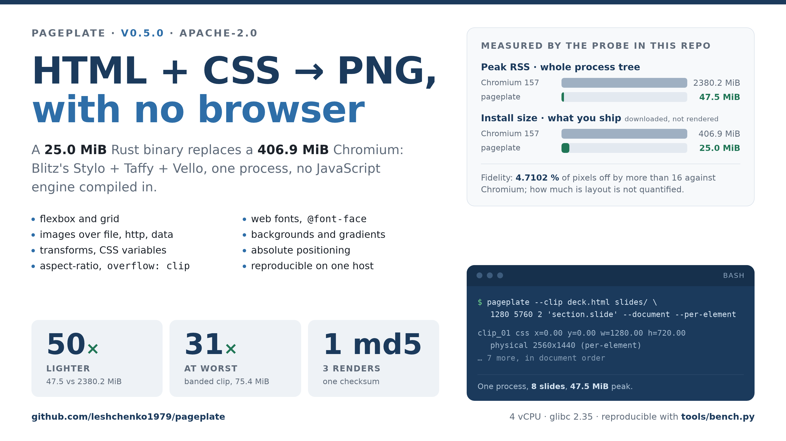

# html-render

HTML and CSS in, PNG out, on a machine with no browser anywhere in the loop.
Rust, one process, one binary.

`0.3.0-beta.8`, one maintainer. Linux x86_64, glibc ≥ 2.35; no macOS, no Windows.



One command produced the PNG above:

```bash
html-render assets/hero.html hero.png 1600 900 2 --document
```

[](https://github.com/leshchenko1979/html-render/actions/workflows/parity.yml)
[](https://github.com/leshchenko1979/html-render/releases)
[](https://github.com/leshchenko1979/html-render/blob/main/LICENSE)

## Why it exists

Rendering a page to an image in CI normally means shipping a browser:
hundreds of megabytes of image,
a JavaScript engine the job never uses,
and a cold start before the first pixel exists.

This reads a file and writes a PNG.
On a 12-slide deck it is **2.34× faster and 3.12× lighter** than headless Chromium
([the measurements](#performance)).
That deck is not in this repo, so those figures are history, not a benchmark you can re-run;
[GATES.md](GATES.md#cost) records the method and the runs behind them.
and there is no language runtime to install first.

Decks, social cards, report one-pagers, CI visual diffs — if the input is HTML plus CSS and the output is an image, that is the entire job.

## Install

Linux x86_64, glibc ≥ 2.35 — Ubuntu 22.04+, Debian 12+, or a current Fedora.
Anything else wants the container below.

```bash
V=v0.3.0-beta.8
N=html-render_0.3.0-beta.8_linux_amd64
BASE="https://github.com/leshchenko1979/html-render/releases/download/$V"
curl -fsSL -O "$BASE/$N.tar.gz" -O "$BASE/checksums.txt"
sha256sum -c checksums.txt && tar xzf "$N.tar.gz"
install -m755 html-render /usr/local/bin/ && html-render --version
```

That is a ~25 MB binary, dynamically linked against 13 shared libraries — glibc,
OpenSSL 3, fontconfig, freetype, expat, libpng, bzip2, brotli, zlib. On a slim
Debian or Ubuntu image the rest is one command:

```bash
apt-get install -y libssl3 libfontconfig1 libfreetype6 libpng16-16 libbz2-1.0 libbrotli1 ca-certificates
```

The container image carries the libraries and a font:

```bash
docker run --rm --user "$(id -u):$(id -g)" --cap-drop ALL --security-opt no-new-privileges \
    -v "$PWD:/work" ghcr.io/leshchenko1979/html-render:latest \
    /work/card.html /work/card.png 1280 720 2
```

`--user` is required, not decorative: the image runs as uid 10001 and exits `101` without it.
Tags are `latest` and `v0.3.0-beta.8`; pin a digest for reproducibility.
Building from source: [CONTRIBUTING.md](CONTRIBUTING.md#building).

## Usage

Both modes take the viewport in CSS pixels; the scale factor multiplies output resolution and is optional for a single image.

```bash
html-render page.html out.png 1280 720 2                            # one PNG
html-render --clip deck.html slides/ 1280 720 2 'section.slide'    # one per match
html-render --clip deck.html slides/ 1280 720 2 'section.slide' --per-element  # lowest memory
# → slides/clip_00.png, clip_01.png, … in document order
```

`--clip` cuts every match out of the document, painted in row bands, so peak memory is one
band rather than the whole page;
`--per-element` paints an element-sized canvas per match instead and holds even less.
`--full` lets a single image run to the document's height rather than the viewport,
painted in row bands and streamed to the encoder, so a tall page is not a memory limit
and has no height ceiling (a `position:fixed` element forces one canvas instead, and says so).
Whether the input is a document or a fragment is auto-detected from the first tag and can be overridden; passing both overrides at once is an error.
Output is deterministic — same input, same bytes — so a changed pixel in CI means a changed document.
A 1280×640 card at scale 2, the shape of `assets/og.png` at 2560×1280, is the same call with different numbers.

Exit codes are a contract, tested in CI against a real binary:

| code | meaning |
|---|---|
| `0` | PNG written, or `--help` / `--version` printed |
| `2` | bad arguments: unknown flag, `--clip` not first, `--per-element` outside `--clip`, `--full` with `--clip`, `--document` with `--fragment` |
| `3` | the selector matched nothing |
| `4` | output written but known to be incomplete: a fetch hit `BLITZ_DEADLINE_SECS`, or a frame was cut to the canvas width |
| `5` | a single canvas would exceed the renderer limit (65408 wide, 65532 tall): nothing written. `--clip` and `--full` band the page, so this now means one *band* or one element is too large, or banding was disabled with `BLITZ_BAND_MIB=0` |
| `101` | panic: unparsable number, invalid selector, unreadable input |

`html-render --help` is the only maintained list of flags.
Five optional environment variables exist for diagnostics —
`BLITZ_BAND_MIB` (`4`), `BLITZ_DEADLINE_SECS` (`120`), `BLITZ_DRAIN` (`quiet`),
`BLITZ_RUNTIME` (current-thread), `BLITZ_TRACE` (unset) —
and stay out of that text because it is tested against the argument parser.

## Performance

One corpus, one host: a 12-slide 4.16 MB deck at 2560×1440, scale 2, medians of repeated runs, peak RSS as the largest single process.

| measurement | Chromium | html-render | ratio |
|---|---|---|---|
| wall clock, `--clip` | 13.36 s | 5.72 s | **2.34×** |
| peak RSS, `--clip` | 858 MiB | 275.2 MiB | **3.12×** |
| wall clock, `--per-element` | 13.36 s | 5.37 s | **2.49×** |
| peak RSS, `--per-element` | 858 MiB | 93.4 MiB | **9.19×** |
| wall clock, `--per-element`, harness sleep removed | 10.42 s | 5.37 s | **1.94×** |

The last row is the one to trust.
The harness makes Chromium wait 1.5 s to settle plus 120 ms per screenshot — 2.94 s of its 13.36 s — and html-render pays none of it, being synchronous.
Strip that out and the honest speed ratio is 1.94, not 2.49.
Memory needs no correction, and its 9.19× is the number that matters under a container limit: 93.4 MiB against a browser's 858 MiB.

Method, host and the runs behind these figures: [GATES.md](GATES.md#cost).

## Fidelity against Chromium

Diffed pixel for pixel against Chromium at the same viewport and scale, a
12-slide deck comes out **4.13 % of pixels differing by more than 16 levels** —
antialiasing and glyph rasterisation, not layout: wrap points match, boxes sit at
Chromium's coordinates, and every photo region lands at a 0 px shift.
That figure comes from the same external deck as the performance rows, so it is
history too: it needs a browser to reproduce and the document is not here.

**The reproducible fidelity number is the corpus**, not the deck. Geometry is
measured over 32 fixtures, every run, against Chromium at the same viewport:
**42 of the 54 text-free rows land exactly** where Chromium puts them, 11
diverge and 1 asserts a shared absence. The 11 are pinned per box in
`tools/parity_baseline.json`, so a further regression fails the build while the
current defects stay visible.
The divergence is concentrated, not spread: **7 rows are one table** (#9) and
**4 are one `<br>` run** (#15). Nothing else in the corpus diverges by more than
1px.

## Limits

- **Linux x86_64 only.** glibc ≥ 2.35; there is no macOS or Windows build.
- **No JavaScript.** A page that needs script renders as the static HTML it shipped with.
- **No PDF, no print layout.** PNG only: no `@page`, no page boxes, no page counters.
- **Blitz's CSS, not Chromium's.** An unsupported property is ignored, not rejected, so a gap shows up as a declaration that did nothing.
- **Dynamically linked.** 13 shared libraries, so the host needs them or you use the container.
- **Beta.** No API promise: flags and output names may move between minor versions.
- **Untrusted input is not sandboxed.** Sub-resources are fetched at render time with no allowlist
  and `file://` is readable ([SECURITY.md](SECURITY.md#what-rendering-does-to-the-machine)).
- **Peak memory is per process.** Counted across the whole process tree the advantage narrows to 5.7–6.1×.
- **Five known defects produce wrong output with exit 0**, measured on `0.3.0-beta.8`:
  a truncated `--document` render (#10), a failed sub-resource that paints an empty box (#11),
  a silently substituted font (#12), table layout off by up to 18px (#9), and `<br>` runs
  shifting content 16px per break (#15). [Read them](https://github.com/leshchenko1979/html-render/issues?q=is%3Aissue+is%3Aopen)
  before putting a render in a pipeline. #9 and #15 are pinned in the corpus gate;
  #11's blank output is pinned as documented behaviour in `tools/test_redirect.py`;
  **#10 and #12 have no test at all**.

## Where the detail lives

| file | holds |
|---|---|
| [GATES.md](GATES.md) | determinism, device scale, element clip, cost, corpus, fidelity, CSS audit |
| [CONTRIBUTING.md](CONTRIBUTING.md) | build requirements, the CI workflows, the rules a change must pass |
| [SECURITY.md](SECURITY.md) | what rendering does to the machine, measured egress, reporting |
| [CHANGELOG.md](CHANGELOG.md) | what moved between releases |

## Contributing

Bug reports with a minimal HTML repro are the most useful thing you can send.
Pull requests are read and reviewed, at the pace of one person on a beta.
Read [CONTRIBUTING.md](CONTRIBUTING.md#rules-that-bite) before opening one.

## Licence

Apache-2.0, with an explicit patent grant. Full text in [LICENSE](LICENSE).
